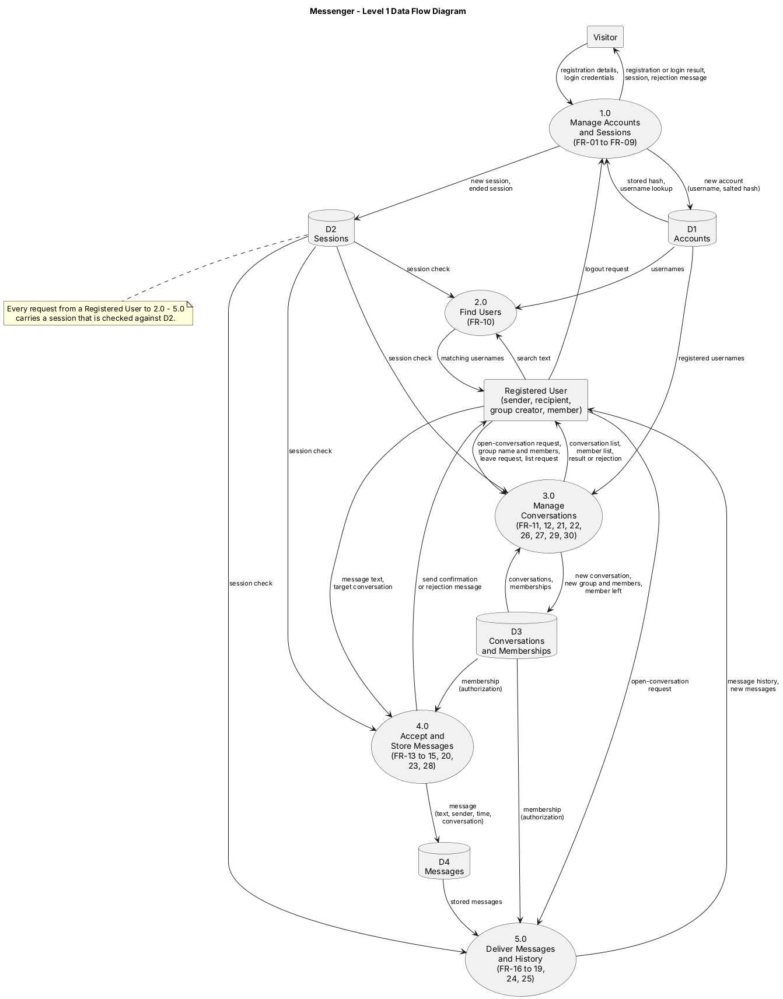
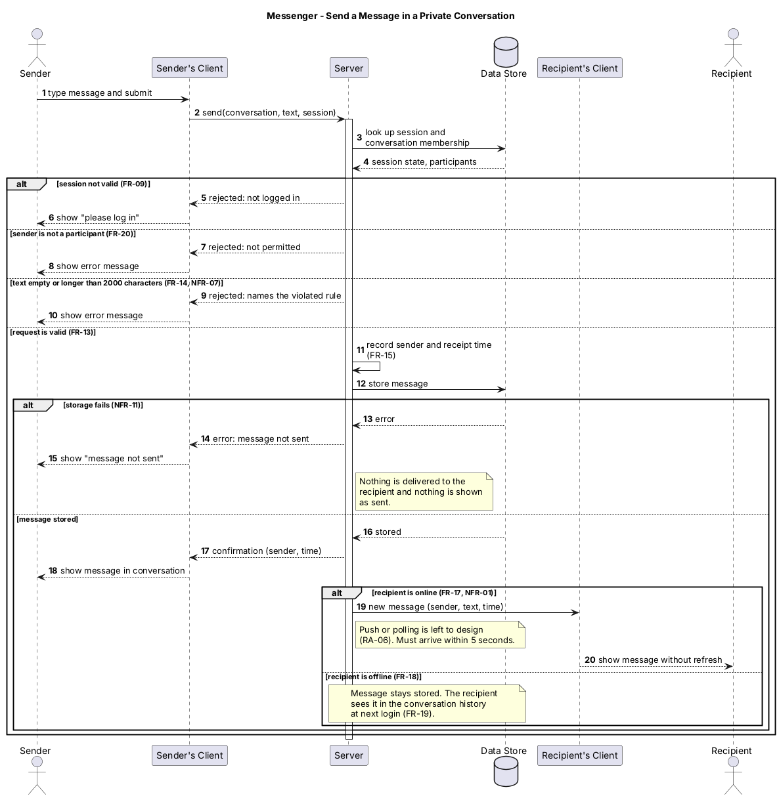

# Messenger — Diagrams and Analysis

This document analyzes the two models of Messenger. Requirement identifiers (`FR-nn`, `NFR-nn`, `RA-nn`, `OQ-nn`) refer to `docs/requirements.md`.

| Model | Authoritative source | Rendered form |
|-------|----------------------|---------------|
| Data flow diagram (DFD) | [`diagrams/data-flow.puml`](diagrams/data-flow.puml) | [`diagrams/data-flow.png`](diagrams/data-flow.png) |
| Sequence diagram | [`diagrams/sequence.puml`](diagrams/sequence.puml) | [`diagrams/sequence.png`](diagrams/sequence.png) |

---

## 1. Data Flow Diagram

### 1.1 Engineering question
Where does information come from, where does it go, what transforms it, and what information must persist?

### 1.2 Requirements most directly represented

| Model element | Requirements |
|---------------|--------------|
| 1.0 Manage Accounts and Sessions | FR-01 to FR-09, FR-32; NFR-05 |
| 2.0 Find Users | FR-10; NFR-03 |
| 3.0 Manage Conversations | FR-11, FR-12, FR-21, FR-22, FR-26, FR-27, FR-29, FR-30 |
| 4.0 Accept and Store Messages | FR-13, FR-14, FR-15, FR-20, FR-23, FR-28; NFR-07, NFR-12 |
| 5.0 Deliver Messages and History | FR-16 to FR-19, FR-24, FR-25; NFR-01 |
| D1 Accounts | FR-01 to FR-07, FR-10, FR-31 |
| D2 Sessions | FR-06, FR-08, FR-09 |
| D3 Conversations and Memberships | FR-11, FR-20, FR-21, FR-27, FR-28, FR-30, FR-31 |
| D4 Messages | FR-13, FR-15, FR-18, FR-19, FR-25, FR-31 |

The two external entities follow the actors in requirements Section 2.2. The Operator is omitted because it moves no information through the system.

### 1.3 What the model makes visible
- **Authorization is a read of stored memberships on every access.** Both 4.0 (sending) and 5.0 (reading) consult D3 before acting (FR-20, FR-28). When a member leaves (FR-27), the next check must already see the change, so group membership is data the system consults constantly, not something checked once.
- **Storing and delivering are separate processes joined only by D4.** 4.0 writes a message and stops; 5.0 reads D4 to serve online recipients (FR-17, FR-24) and later history requests (FR-18, FR-19, FR-25). One store therefore serves both cases, and no per-recipient delivery queue is needed for offline users.
- **Messages carry their own sender.** D4 records the sender with each message instead of depending on D3, which is why a member's earlier messages stay visible after they leave (FR-27).
- **Persistent information is D1, D3, and D4**, which matches FR-31. Everything else in the diagram is a transformation or an external interaction.

### 1.4 Findings

**F-1: "Online" is undefined (ambiguity).** FR-17, FR-18, FR-24, and NFR-01 all depend on whether a recipient is "online", but the requirements do not say what that means. The DFD shows why it matters: 5.0 must decide who gets new messages immediately and who gets them from history. *Resolution:* added assumption RA-17 to the requirements: a user is online when they have a valid session and the client open.

**F-2: Sessions are a data store the requirements do not cover (missing requirement).** The DFD needs D2 because every process from 2.0 to 5.0 checks a session (FR-09). FR-31 lists what survives a restart (accounts, conversations, memberships, messages) but not sessions, and nothing says whether one user may be logged in from more than one browser. *Resolution:* recorded as unresolved question OQ-10 in the requirements, with no answer assumed.

**F-3: Visibility of newly created conversations is unspecified (design question).** 3.0 writes new conversations and groups to D3, but no requirement says when another user sees them. FR-30 gives each user a list, and FR-17/FR-24 give a 5-second target for messages, but a user added to a new group by someone else, or a private conversation started by someone else, is not covered. *Status:* carried forward to the design document. The likely rule is that a group appears for its members when created and a private conversation appears for the recipient with its first message; if the client expects this to be immediate, FR-30 should receive the same 5-second wording as FR-17. No requirement was changed.

---

## 2. Sequence Diagram

**Scenario:** A user sends a message in a private conversation. This scenario was chosen because it is the central behavior of the system, and it contains the checks, the ordering, and the delivery timing that most requirements depend on. Sending in a group follows the same sequence, with a membership check against the group (FR-28) and delivery to every online member (FR-24).

### 2.1 Engineering question
Who communicates with whom, in what order, and what happens when the scenario does not follow only the ideal path?

### 2.2 Requirements most directly represented
FR-09 (session required), FR-13 (send a message), FR-14 (reject invalid text), FR-15 (sender and receipt time), FR-17 (online delivery within 5 seconds), FR-18 and FR-19 (offline recipient sees the message in history), FR-20 (only participants); NFR-01 (delivery time), NFR-07 (invalid input rejected with the rule named), NFR-11 (storage failure, added by this analysis), and NFR-12 (message rate limit, added later from the ethics reflection).

### 2.3 What the model makes visible
- **The server is the single authority.** It looks up the session and the conversation's participants, checks the text, assigns the receipt time, stores the message, and decides who is notified. The client only submits and displays, so every rule must hold even when a request does not come from the client's own interface (this is why AC-06 and AC-14 test requests made directly).
- **Order matters: store, then confirm and deliver.** The sender sees the message as sent, and the recipient receives it, only after the Data Store has accepted it. Showing or delivering a message that was never stored would break "not lost" (O4) and make history disagree with what users saw.
- **The sender's screen waits for confirmation.** The message appears in the sender's conversation after step 17, not when it is typed, so a failure can never leave a message on screen that does not exist.
- **Failure paths are different responsibilities.** A bad session, a non-participant, and invalid text are each rejected before anything is stored; only a storage failure occurs after the server has accepted the request. A message over the rate limit (NFR-12), added after this diagram was drawn, is another rejection of the first kind: it is refused before anything is stored.

### 2.4 Findings

**F-4: Storage failure was not covered by any requirement (missing requirement).** The diagram needs a path for the Data Store failing during "store message", and it materially changes what the sender and recipient see. The requirements had no statement of it; NFR-07 covers invalid input, not a failing store. *Resolution:* added NFR-11 (the sender is told the message was not sent, nothing is delivered, and a message is shown as sent only after it is stored) and acceptance criterion AC-25.

**F-5: Push or polling changes the shape of the delivery step (design question).** Message 19 is drawn as the server sending the message to the recipient's client, but RA-06 deliberately leaves the mechanism open. With polling, the recipient's client would ask for new messages repeatedly and the server would only answer; with push, the server initiates. Both can meet the 5-second target (FR-17, NFR-01), but they differ in what the server must track about connected clients (see also F-1). *Status:* the diagram shows delivery generically and notes the choice; the decision belongs in the design document, and no requirement was changed.

---

## 3. Consistency and Revisions

### 3.1 Changes made to `docs/requirements.md`
The models exposed the following, and the requirements were updated to match.

| Change | Reason |
|--------|--------|
| Added **RA-17** (definition of "online") | F-1 |
| Added **OQ-10** (do sessions survive restart; multiple simultaneous sessions) | F-2 |
| Added **NFR-11** and **AC-25** (storage failure), with traceability rows | F-4 |
| Added **FR-32** (registration notice) and **NFR-12** (message rate limit) with AC-26 and AC-27, plus traceability rows | Ethics reflection, Sections 2.1 and 2.2 |
| Corrected stale references: acceptance-criterion numbers in the NFR table, the browser-compatibility reference in Section 2.3 (now NFR-10), the heading of 4.5, and dangling references in the final section | Consistency of identifiers |

### 3.2 Statement of Work
Both diagrams follow the requirements. The Statement of Work has been revised to match the requirements (CF-01 to CF-07, listed in requirements Section 8).

### 3.3 Not changed
F-3 and F-5 are recorded as design questions for `docs/design.md` rather than requirements changes, because they concern how the system is built or when something appears, not what it must do.
