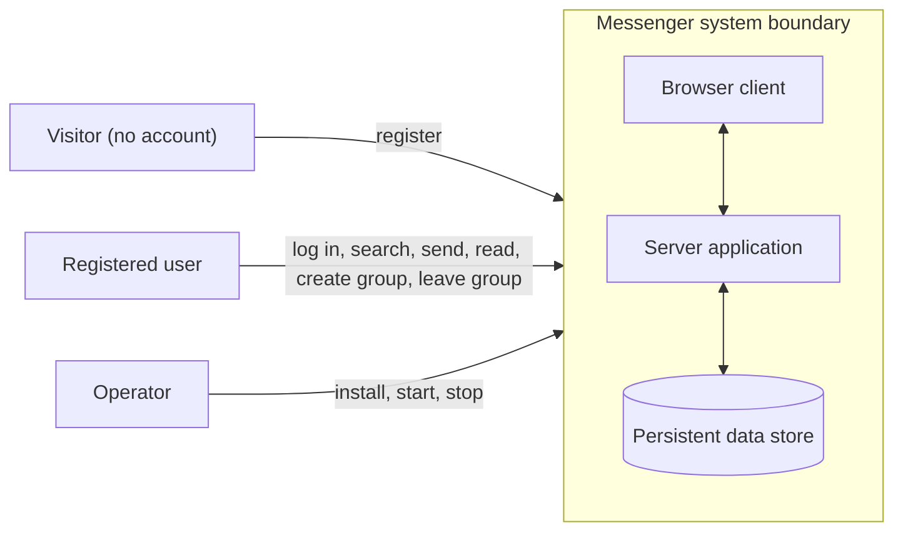

# Messenger — Requirements Specification

## 1. Introduction

### 1.1 Purpose
This document states what Messenger shall do and how well it shall do it, precisely enough to be reviewed, designed, and tested. It describes the same project defined in the SOW: registered users communicate through private one-to-one conversations and flat group conversations. 

### 1.2 Identifiers and references
Requirements and related items have stable identifiers that are never reused: `FR-nn` (functional requirement), `NFR-nn` (non-functional requirement), `AC-nn` (acceptance criterion), `RA-nn` (assumption or engineering decision), `OQ-nn` (unresolved question), and `CF-nn` (conflict or ambiguity). Section 7 gives the source of every requirement using these references: `O1`–`O6` (objectives, SOW §1.2), `SOW §3.1 <heading>` (an in-scope capability), `STK <name>` (a stakeholder need, SOW §2), `A1`–`A8` (SOW assumptions), `RA-nn` (a documented engineering decision), and `AN F-n` or `ER §n` (a finding in `docs/analysis.md` or a section of `docs/ethics-reflection.md`).

## 2. System Context

### 2.1 System boundary
**Messenger** consists of the server-side application that holds accounts, conversations, and messages, the browser-based client through which users interact (SOW assumption A2), and the persistent data store. Everything a user does with Messenger happens through the client; the system's only durable state lives in the data store.

### 2.2 Actors

| Actor | Description | Interactions with Messenger |
|-------|-------------|-----------------------------|
| Visitor | A person without an account or not logged in. | Registers; logs in. Can do nothing else. |
| Registered user | A person with an account. Acts in several roles within a conversation: *sender*, *recipient*, *group creator*, *group member*. | Logs in and out; searches for users; opens, reads, and sends in conversations; creates and leaves groups. |
| Operator | Whoever installs and runs the system (initially the developer). | Sets up and starts the system from the README. Has no special in-application privileges. |

### 2.3 External systems
Messenger has no required interaction with external services. It sends no email, uses no third-party sign-in, sends no push notifications, and integrates with no other chat service. The only things outside the boundary that it touches are:

| External element | Interaction |
|------------------|-------------|
| User's web browser | Hosts the client; the system supports current Chrome and Firefox (NFR-10). |
| Host machine (OS, file system, network) | Runs the server and stores the data store. |

---

## 3. Functional Requirements

Every functional requirement has at least one acceptance criterion in Section 5 (the **AC** column).

### 3.1 Accounts and sessions

| ID | Requirement | AC |
|----|-------------|----|
| FR-01 | The system shall allow a visitor to register an account by supplying a username and a password. | AC-01 |
| FR-02 | The system shall accept only usernames of 3–20 characters consisting of letters, digits, and underscores, and shall treat usernames as unique ignoring letter case (e.g., "Sam" and "sam" are the same username). | AC-01, AC-02 |
| FR-03 | The system shall accept only passwords of 8–128 characters. | AC-01, AC-02 |
| FR-04 | If registration input violates FR-02 or FR-03, or the username is already taken, the system shall create no account and shall display a message identifying which rule was violated. | AC-02 |
| FR-05 | The system shall store only a salted hash of each password and shall never store or log a password in plaintext. | AC-03 |
| FR-06 | The system shall allow a registered user to log in with a username (compared ignoring case) and password, establishing an authenticated session. | AC-01, AC-04 |
| FR-07 | If login credentials are incorrect, the system shall establish no session and shall display one generic message that does not reveal whether the username or the password was wrong. | AC-04 |
| FR-08 | The system shall allow an authenticated user to log out, after which the ended session shall no longer grant access to any function. | AC-05 |
| FR-09 | The system shall make every function other than registration and login available only to authenticated users. | AC-06 |
| FR-32 | The system shall display on the registration page, before an account is created, a notice that messages are stored without end-to-end encryption and can be read by the operator. | AC-27 |

### 3.2 Finding users

| ID | Requirement | AC |
|----|-------------|----|
| FR-10 | The system shall allow an authenticated user to search for registered users by entering at least one character of a username, returning at most 20 usernames that begin with the entered text (ignoring case), excluding the searcher, and no other account data. An empty search shall return no results. | AC-07 |

### 3.3 Private messaging

| ID | Requirement | AC |
|----|-------------|----|
| FR-11 | The system shall allow an authenticated user to open a private conversation with another registered user, chosen from search results or by entering the exact username. At most one private conversation shall exist per pair of users; choosing a user with whom a conversation exists shall open that conversation. | AC-08 |
| FR-12 | The system shall not allow a user to open a private conversation with themselves. | AC-08 |
| FR-13 | The system shall allow a participant to send a text message of 1–2000 characters in a conversation in which they are a participant or member. | AC-09 |
| FR-14 | If a message is empty or exceeds 2000 characters, the system shall not store or deliver it and shall display a message identifying the violated rule. | AC-10 |
| FR-15 | The system shall record, and display with each message, the sender's username and the time the system received the message. | AC-09 |
| FR-16 | The system shall display the messages of a conversation in order of the system-recorded receipt time, oldest first. | AC-13 |
| FR-17 | When a message is sent in a conversation, the system shall display it to each online participant (other than the sender) within 5 seconds, without the participant refreshing the page or taking any action. | AC-11 |
| FR-18 | When a message is sent while a recipient is not online, the system shall retain it and display it in that conversation's history when the recipient next logs in. | AC-12 |
| FR-19 | The system shall allow a participant to open a private conversation and view all of its stored messages. | AC-13 |
| FR-20 | The system shall permit only the two participants of a private conversation to read it or send messages in it, and shall reject any request from any other user. | AC-14 |

### 3.4 Group messaging

| ID | Requirement | AC |
|----|-------------|----|
| FR-21 | The system shall allow an authenticated user to create a group by supplying a group name of 1–50 characters and selecting 1 to 19 other registered users as its initial members, so that a group has 2–20 members including its creator. The creator shall become a member and shall be recorded as the group's owner. | AC-15 |
| FR-22 | If group creation input violates FR-21 (invalid name, no other member selected, too many members, or a selected user who does not exist), the system shall create no group and shall display a message identifying the violated rule. | AC-16 |
| FR-23 | The system shall allow a current member of a group to send a message in that group under the rules of FR-13 and FR-14. | AC-17 |
| FR-24 | When a message is sent in a group, the system shall display it to each online member other than the sender within 5 seconds without refreshing (as in FR-17), and shall retain it for each member who is not online until they next log in (as in FR-18). | AC-17 |
| FR-25 | The system shall allow a current member to open a group and view all of the group's stored messages, with the sender's username on each. | AC-13, AC-17 |
| FR-26 | The system shall allow a current member to view the usernames of the group's current members. | AC-15 |
| FR-27 | The system shall allow a member to leave a group. After leaving, the group shall no longer appear in that user's conversation list, the user shall not be able to read it or send in it, and the user shall receive no further messages from it. Messages the user sent earlier shall remain visible to the remaining members. | AC-18 |
| FR-28 | The system shall permit only current members of a group to read it or send messages in it, and shall reject any request from any other user. | AC-19 |
| FR-29 | The system shall keep a group and its messages available to its remaining members when its owner leaves; ownership shall confer no additional capabilities. | AC-20 |

### 3.5 Navigation and persistence

| ID | Requirement | AC |
|----|-------------|----|
| FR-30 | The system shall show each authenticated user a list of the private conversations and groups they currently participate in, from which any can be opened. | AC-13 |
| FR-31 | The system shall retain all accounts, conversations, memberships, and messages across a restart of the application, so that every item stored before the restart is available after it. | AC-21 |

---

## 4. Non-Functional Requirements

### 4.1 Performance and capacity

| ID | Requirement | AC |
|----|-------------|----|
| NFR-01 | With 10 users logged in simultaneously, every message sent shall be displayed to all of its online recipients within 5 seconds of being sent. | AC-11, AC-23 |
| NFR-02 | Opening a conversation that contains 100 stored messages shall display its messages within 3 seconds. | AC-23 |
| NFR-03 | A user search shall return its results within 1 second with 100 registered users. | AC-23 |
| NFR-04 | The system shall operate without errors or lost messages with at least 10 simultaneously logged-in users and 100 registered accounts. | AC-23 |

### 4.2 Security

| ID | Requirement | AC |
|----|-------------|----|
| NFR-05 | Password hashes shall be produced with a per-password random salt and an established, deliberately slow password-hashing algorithm, and the algorithm and its parameters shall be named in the design document. | AC-03 |
| NFR-06 | No response of the system shall contain a password hash, or any information about another user beyond their username, or the content of any conversation in which the requester is not a participant or member. | AC-22 |
| NFR-12 | The system shall accept at most 30 messages from any one user in any 60-second period, across all conversations. A further message in that period shall not be stored or delivered, and the sender shall be shown a message naming the limit. | AC-26 |

### 4.3 Reliability

| ID | Requirement | AC |
|----|-------------|----|
| NFR-07 | Invalid input (any case covered by FR-04, FR-14, FR-22, NFR-12, or malformed requests) shall not crash the application or corrupt stored data, and each rejection shall name the specific rule violated. | AC-02, AC-10, AC-16, AC-26 |
| NFR-11 | If the data store fails while a message is being stored, the system shall tell the sender that the message was not sent and shall deliver it to no one. A message shall be shown as sent, and delivered, only after it has been stored. | AC-25 |

### 4.4 Usability

| ID | Requirement | AC |
|----|-------------|----|
| NFR-08 | Starting from the landing page, each of these tasks shall be completable in at most 6 user actions (a click, selection, or form submission): register; log in; open a private conversation with a known username; send a message; create a group; leave a group. | AC-24 |
| NFR-09 | Error messages shall state what is wrong and how to correct it in plain language, and shall not expose internal details such as stack traces, file paths, or database errors. | AC-24 |

### 4.5 Portability

| ID | Requirement | AC |
|----|-------------|----|
| NFR-10 | The client shall work in the current stable releases of Chrome and Firefox. | AC-24 |

---

## 5. Acceptance Criteria

Each criterion states how to observe that the requirements listed under **Verifies** are satisfied. Users A, B, and C are distinct registered users unless stated.

| ID | Verifies | Procedure | Expected observable result |
|----|----------|-----------|----------------------------|
| AC-01 | FR-01, 02, 03, 06 | Register "alice_1" with an 8-character password; log in with those credentials. | The account is created and login succeeds. |
| AC-02 | FR-02, 03, 04; NFR-07 | Attempt to register: (a) username "ab"; (b) a username containing a space; (c) "ALICE_1" when "alice_1" exists; (d) a 7-character password. | Each attempt is rejected with a message naming the violated rule; no account is created; the application keeps running. |
| AC-03 | FR-05; NFR-05 | Register a user, then inspect the data store and logs. | The password appears in neither; the stored value is a salted hash; two users with the same password have different stored values; the design document names the algorithm. |
| AC-04 | FR-06, 07 | Log in with (a) a wrong password for an existing user and (b) a nonexistent username. | Both are rejected with the same message; no session exists afterward. |
| AC-05 | FR-08 | Log in, log out, then repeat a request using the old session. | The request is rejected. |
| AC-06 | FR-09 | Without logging in, request the conversation list, a search, and a message send directly. | Every request is rejected; none returns data. |
| AC-07 | FR-10 | As a logged-in user, with existing users "alice_1", "alan", and "bob", search "al", "AL", "" (empty), "zz", and the searcher's own username prefix. | "al" and "AL" each return exactly "alice_1" and "alan"; the empty search and "zz" return nothing; the searcher is never listed; results contain usernames only. With more than 20 matching users, exactly 20 are returned. |
| AC-08 | FR-11, 12 | A opens a conversation with B by search, and again by typing B's username; A attempts a conversation with A. | One conversation with B exists (the second attempt opens the same one); the self-conversation is refused. |
| AC-09 | FR-13, 15 | A sends "hello" to B. | The message appears with A's username and a timestamp. |
| AC-10 | FR-14; NFR-07 | A sends (a) an empty message and (b) a 2001-character message; then a 2000-character message. | (a) and (b) are rejected with a message naming the rule and are not stored or delivered; the 2000-character message is accepted. |
| AC-11 | FR-17; NFR-01 | A and B are online and viewing their conversation; A sends a message; time its appearance on B's screen without B acting. | It appears within 5 seconds; no refresh is needed. |
| AC-12 | FR-18 | B logs out; A sends two messages; B logs in. | Both messages appear in the conversation with B, in order. |
| AC-13 | FR-16, 19, 25, 30 | A and B exchange 10 messages in alternation; B is also in a group with A and C. Open each user's conversation list, then the private conversation and the group. | Each list shows the private conversation and the group; messages appear oldest first; the full history is shown. |
| AC-14 | FR-20 | C requests the messages of the A–B conversation and attempts to send in it, directly and through the interface. | Both are rejected; no message content is returned to C. |
| AC-15 | FR-21, 26 | A creates the group "team" with members B and C. | The group exists with A, B, and C as members; A is recorded as owner; each member sees the group in their list and can view the member list. |
| AC-16 | FR-22; NFR-07 | A attempts to create a group with (a) an empty name, (b) a 51-character name, (c) no other member, (d) 20 other members, (e) a nonexistent user. | Each is rejected with a message naming the violated rule; no group is created. |
| AC-17 | FR-23, 24, 25 | B sends a message in the group while A is online and C is offline; C then logs in. | A sees it within 5 seconds without refreshing; C sees it after logging in; every member sees the same messages with sender usernames. |
| AC-18 | FR-27 | C leaves "team"; A then sends a message in the group; C tries to open the group and to send. | The group is gone from C's list; C never sees the new message; C's attempts are rejected; C's earlier messages remain visible to A and B. |
| AC-19 | FR-28 | A user who is not a member requests the group's messages and attempts to send, directly and through the interface. | Both are rejected; no content is returned. |
| AC-20 | FR-29 | The owner leaves a group that has two remaining members, who then exchange messages. | The group remains available to them; no privileges change. |
| AC-21 | FR-31 | Create accounts, a private conversation, and a group with messages; stop and restart the application; log in. | All accounts can log in; the conversations, memberships, and all earlier messages are present. |
| AC-22 | NFR-06 | Inspect all server responses during AC-07, AC-13, and AC-15 with a network tool. | No response contains a password hash, account data other than usernames, or messages of a conversation the requester is not in. |
| AC-23 | NFR-01, 02, 03, 04 | With 10 simulated logged-in users and 100 registered accounts, have each user send messages in private conversations and groups for 5 minutes, each sending no more than 30 messages per minute; separately open a conversation containing 100 messages; run a search. | Every message arrives within 5 seconds; none is lost and no error occurs; the 100-message conversation displays within 3 seconds; the search returns within 1 second. |
| AC-24 | NFR-08, 09, 10 | (a) Count the user actions needed for each task listed in NFR-08; (b) provoke each validation error and read its message; (c) use the client in current Chrome and Firefox. | (a) Each task takes at most 6 actions; (b) each message is plain-language, says how to correct the problem, and shows no internal details; (c) all functions work in both browsers. |
| AC-25 | NFR-11 | With A and B online, make the data store unavailable (for example, stop it or make it read-only) and have A send a message to B; then restore the store. | A is told the message was not sent, in plain language and without internal details; B receives nothing; the message is not in A's conversation, B's conversation, or the stored history. |
| AC-26 | NFR-12; NFR-07 | A sends 30 messages within 60 seconds, then a 31st within the same 60 seconds, then another after the 60 seconds have passed. | The first 30 are accepted; the 31st is rejected with a message naming the limit and is not stored or delivered; the later message is accepted. |
| AC-27 | FR-32 | Open the registration page without logging in. | Before submitting, the page shows a notice that messages are stored without end-to-end encryption and can be read by the operator. |

---

## 6. Assumptions and Unresolved Questions

### 6.1 Assumptions and engineering decisions
The SOW assumptions A1–A8 apply. Where the SOW or scenario is silent, the following were assumed or decided so that requirements could be stated precisely.

| ID | Assumption or decision | Affects |
|----|------------------------|---------|
| RA-01 | Usernames are 3–20 letters, digits, or underscores, unique ignoring letter case. | FR-02, FR-04, FR-06 |
| RA-02 | Passwords are 8–128 characters, with no composition rules. | FR-03 |
| RA-03 | Messages are plain text of 1–2000 characters. (SOW A3 requires a "reasonable length limit" without stating one.) | FR-13, FR-14 |
| RA-04 | A group has 2–20 members including its creator. Members are chosen when the group is created and change afterward only by leaving. | FR-21, FR-22, FR-27 |
| RA-05 | The group owner is recorded but has no additional capabilities, because no group-management function is in scope. | FR-21, FR-29 |
| RA-06 | "Near-real-time" means within 5 seconds with no user action; whether this is done by push or polling is left to design. | FR-17, FR-24, NFR-01 |
| RA-07 | Search is a case-insensitive prefix match of at least 1 character, returns at most 20 usernames, excludes the searcher, and returns nothing for an empty query. | FR-10 |
| RA-08 | Exactly one private conversation exists per pair of users, and none with oneself. | FR-11, FR-12 |
| RA-09 | Message timestamps are set by the server at receipt, and the server clock is correct. | FR-15, FR-16 |
| RA-10 | A user who leaves a group loses access to it, including its history; remaining members keep the messages. | FR-27 |
| RA-11 | A failed login does not reveal whether the username exists. | FR-07 |
| RA-12 | Messenger runs as one instance on one machine with one data store, at the small load stated in NFR-04 (SOW A4). | NFR-01 to NFR-04 |
| RA-13 | Users use a desktop-size browser window; the interface is in English only. | NFR-08, NFR-10 |
| RA-14 | The delivered system runs locally for demonstration and is not exposed to the public internet, so transport encryption is not required (see OQ-03). | NFR-05, NFR-06 |
| RA-15 | Accounts cannot be deleted or renamed, and passwords cannot be changed or recovered. | FR-01 to FR-09 |
| RA-16 | There is no moderation, blocking, reporting, or administrator role, apart from the message rate limit (NFR-12); all registered users have equal standing. | Scope, NFR-12 |
| RA-17 | A user is online when they have a valid session and the client open. (Found in the data flow analysis, AN F-1.) | FR-17, FR-18, FR-24, NFR-01 |

### 6.2 Unresolved questions for the client
These are unanswered. The "default used" column records what this document assumes meanwhile; it is not a client answer.

| ID | Question | Default used | Affects |
|----|----------|--------------|---------|
| OQ-01 | Is a browser-based client acceptable, or is another platform required? | Browser client (SOW A2) | NFR-10 |
| OQ-02 | Is open self-registration acceptable, or must accounts be approved or invited? | Open registration (SOW A5) | FR-01 |
| OQ-03 | Must data in transit be encrypted (HTTPS/TLS), or is a local demonstration without it acceptable? | Not required (RA-14) | NFR-05, NFR-06 |
| OQ-04 | What are the real limits on group size and message length, and how long must messages be kept? | 20 members, 2000 characters, kept indefinitely (RA-03, RA-04, RA-10) | FR-13, FR-21, FR-31 |
| OQ-05 | Should members be addable after a group is created, or able to rejoin after leaving? | No (RA-04) | FR-21, FR-27 |
| OQ-06 | Should sessions expire after a period of inactivity or time? | No expiry other than logout | FR-08 |
| OQ-07 | Is it acceptable that a user who forgets their password cannot recover the account? | Yes (RA-15) | FR-06 |
| OQ-08 | Is it acceptable that abusive users cannot be blocked, reported, or moderated? | Yes (RA-16); examined further in the ethics reflection | Scope |
| OQ-09 | Is it acceptable that any registered user can discover other usernames through search? | Yes, bounded by RA-07 | FR-10 |
| OQ-10 | Do sessions survive an application restart, and may one user be logged in from more than one browser at once? (AN F-2) | None assumed; decided in the design document | FR-08, FR-09, FR-31 |

### 6.3 Conflicts and ambiguities in the SOW
Writing precise requirements exposed these. Each is resolved here as shown, and the SOW has been revised to match (Section 8).

| ID | Issue | Resolution in this document |
|----|-------|-----------------------------|
| CF-01 | SOW §3.1 says a group is created "with a name" and members can leave, but nothing adds members; SOW §7.1 criterion 6 describes a group created "with chosen members". A group of one cannot function. | Members are chosen at creation (RA-04; FR-21). |
| CF-02 | The SOW makes the creator the "group owner" and lists group owners as drivers of "group-management requirements", but no group-management function is in scope. | Ownership is recorded with no extra capabilities (RA-05; FR-29). |
| CF-03 | "Near-real-time" (SOW §3.1) and "within about 5 seconds" (SOW §7.1) are not testable. | Fixed at 5 seconds (RA-06; FR-17, FR-24, NFR-01). |
| CF-04 | User search is in scope (SOW §3.1) but has no SOW acceptance criterion. | Defined by RA-07 and FR-10; verified by AC-07. |
| CF-05 | "Reasonable length limit" (SOW A3), "securely" (O1), and "promptly" (O4) are not measurable. | Given figures and specifics in RA-03, FR-05, NFR-05, NFR-06, and NFR-01. |
| CF-06 | Search makes usernames discoverable, which may conflict with privacy expectations. | Bounded search (RA-07); client question OQ-09. |
| CF-07 | The SOW excludes end-to-end encryption but is silent on transport security. | Open question OQ-03; assumption RA-14. |

---

## 7. Traceability

### 7.1 Source of each requirement

| ID | Source |
|----|--------|
| FR-01 | O1; SOW §3.1 Accounts |
| FR-02 | O1; SOW §3.1 Accounts ("unique usernames"); RA-01 |
| FR-03 | O1; RA-02 |
| FR-04 | O1; SOW §3.1 input validation |
| FR-05 | O1; SOW §3.1 Accounts ("salted hashing") |
| FR-06 | O1; SOW §3.1 Accounts |
| FR-07 | O1; RA-11 |
| FR-08 | O1; SOW §3.1 Accounts |
| FR-09 | O1; SOW §3.1 access control |
| FR-10 | SOW §3.1 Supporting functionality ("search for users by username prefix"); RA-07 |
| FR-11 | O2; SOW §3.1 Private messaging; RA-08 |
| FR-12 | RA-08 |
| FR-13 | O2, O3; SOW §3.1 (send and receive text); SOW A3; RA-03 |
| FR-14 | SOW §3.1 input validation; RA-03 |
| FR-15 | O2; RA-09 |
| FR-16 | O2; RA-09 |
| FR-17 | O4; SOW §3.1 Private messaging ("delivery within 5 seconds"); RA-06 |
| FR-18 | O4; SOW §3.1 Private messaging ("delivery on next login") |
| FR-19 | O2; SOW §3.1 Private messaging ("history is viewable") |
| FR-20 | O1; SOW §3.1 access control |
| FR-21 | O3; SOW §3.1 Group messaging; RA-04, RA-05 |
| FR-22 | SOW §3.1 input validation; RA-04 |
| FR-23 | O3; SOW §3.1 Group messaging |
| FR-24 | O3, O4; SOW §3.1 Group messaging; RA-06 |
| FR-25 | O3; SOW §3.1 Group messaging ("persistent history") |
| FR-26 | O3; STK End users (members need to know who can read their messages) |
| FR-27 | O3; SOW §3.1 Group messaging ("members can leave"); RA-04, RA-10 |
| FR-28 | O1; SOW §3.1 access control |
| FR-29 | RA-05; CF-02 |
| FR-30 | O2, O3 (stored history cannot be reached without a conversation list) |
| FR-31 | O4; SOW §3.1 persistent storage |
| FR-32 | STK End users; ER §2.2 |
| NFR-01 | O4; SOW A4; RA-06, RA-12 |
| NFR-02 | O2; STK End users |
| NFR-03 | SOW A4; RA-12; FR-10 |
| NFR-04 | SOW A4; RA-12 |
| NFR-05 | O1; FR-05 |
| NFR-06 | O1; SOW §3.1 access control |
| NFR-07 | SOW §3.1 input validation; FR-04, FR-14, FR-22 |
| NFR-08 | STK End users |
| NFR-09 | STK End users |
| NFR-10 | SOW A2; RA-13 |
| NFR-11 | O4; AN F-4 |
| NFR-12 | STK End users; ER §2.1 |

### 7.2 SOW elements to requirements
This table shows that the requirements cover the SOW; every FR and NFR also appears in the **AC** column of its table, so each is paired with an acceptance criterion.

| SOW element | Requirements |
|-------------|--------------|
| O1 Identity and secure access | FR-01 to FR-09, FR-20, FR-28; NFR-05, NFR-06 |
| O2 Private messaging with history | FR-11 to FR-16, FR-19, FR-30; NFR-02 |
| O3 Group conversation | FR-13, FR-21 to FR-30 |
| O4 Prompt delivery, no lost messages | FR-17, FR-18, FR-24, FR-31; NFR-01, NFR-11 |
| O5 Delivered with evidence | Section 5 (acceptance criteria define the evidence) |
| O6 Ambiguities surfaced | Section 6 |
| Registration, login, logout; unique usernames | FR-01 to FR-04, FR-06 to FR-08 |
| Salted password hashing | FR-05; NFR-05 |
| Start a one-to-one conversation | FR-11, FR-12 |
| Send and receive text; persistent, viewable history | FR-13 to FR-16, FR-19, FR-31 |
| Delivery within 5 seconds; delivery on next login | FR-17, FR-18; NFR-01 |
| Create a group; creator becomes owner | FR-21, FR-22, FR-29 |
| Members can leave | FR-27 |
| Group messages visible to all members; persistent history | FR-23 to FR-25 |
| Search for users by username prefix | FR-10; NFR-03 |
| Client user interface | FR-30; NFR-08, NFR-10 |
| Persistent storage | FR-31 |
| Input validation and basic access control | FR-04, FR-09, FR-14, FR-20, FR-22, FR-28; NFR-07 |
| Message rate limit | NFR-12 |
| Registration notice | FR-32 |
| Message not sent if it cannot be stored | NFR-11 |

