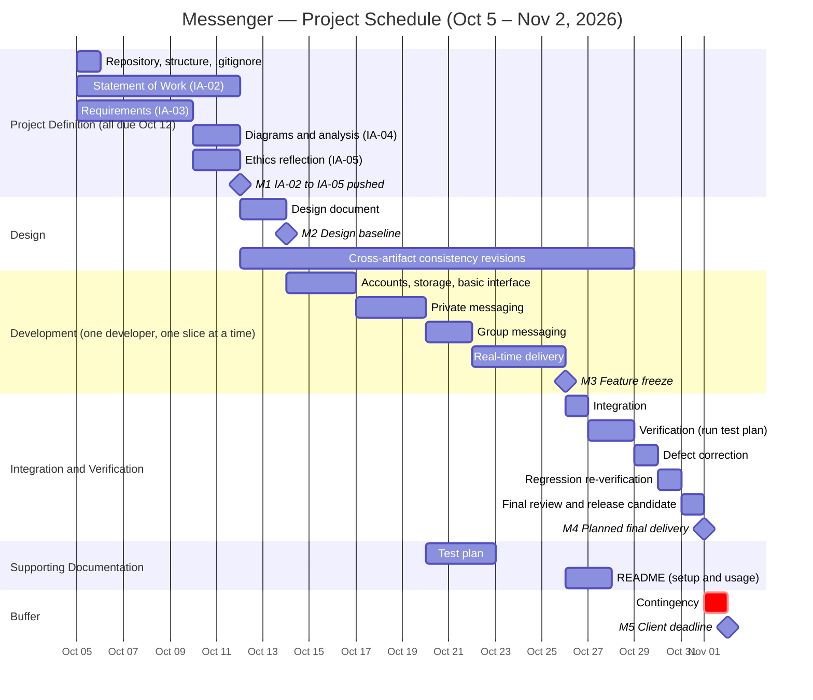

# Statement of Work

## 1. Purpose and Objectives

### 1.1 Purpose
This messenger application will be a communication app that allows for users to talk with each other in both private one-on-one chats and in groups. The client wants this to be similar in purpose to Discord, but has not supplied a complete specification.

### 1.2 Objectives
| ID | Objective (desired outcome) |
|----|-----------------------------|
| O1 | Users can establish an identity and securely access the system. |
| O2 | Two users can exchange messages privately, and see prior conversation history. |
| O3 | Multiple users can communicate together in a shared group conversation. |
| O4 | Messages reach recipients promptly while they are using the system, and are not lost. |
| O5 | The product is delivered with evidence (tests, documentation) that it works as agreed. |
| O6 | Ambiguities in the client's request are surfaced, decided, or recorded as open questions rather than silently resolved. |

---

## 2. Stakeholders
| Stakeholder | Relationship to the project |
|-------------|-----------------------------|
| Client | Defines the need, reviews deliverables, decides open questions. |
| End users | Use private and group messaging; their needs drive usability and reliability requirements. |
| Group owners/creators | A subset of users who create and manage groups; drive group-management requirements. |
| Developer | Plans, designs, builds, tests, and delivers the system. |
| Course instructor / reviewers | Evaluate the repository, documents, and delivered product against the course criteria. |
| Future maintainers | May extend the system; depend on documentation and clear structure. |
| System operator/host | Whoever runs the deployed system; depends on setup and configuration documentation. |

---

## 3. Scope

### 3.1 In scope
**Accounts**
- Registration, login, and logout for users with unique usernames.
- Password storage using salted hashing (no plaintext passwords).

**Private messaging**
- Start a one-to-one conversation with any other registered user.
- Send and receive text messages; messages persist and conversation history is viewable.
- Near-real-time delivery to recipients who are online; delivery on next login otherwise.

**Group messaging**
- Create a group with a name; creator becomes group owner.
- Members can leave.
- Send and receive text messages visible to all current members; persistent history.

**Supporting functionality**
- User list/search by username.
- A client user interface (web-based, see Assumption A2) for all of the above.
- Persistent storage of users, conversations, memberships, and messages.
- Input validation and basic access control (only participants can read a conversation).

**Project work**
- Requirements, diagrams and analysis, and an ethics reflection for Messenger (the four graded Messenger artifacts), plus design documentation, test plan and results, setup/user guide, and the working software.
- Maintaining a consistent, well-organized course repository, including revising earlier artifacts when later analysis exposes gaps.

### 3.2 Out of scope
- Voice, video, or screen sharing.
- File, image, or attachment uploads; rich embeds and link previews.
- Servers/guilds with multiple channels, roles, and fine-grained permissions (groups are single flat conversations).
- Message editing, deletion, reactions, threading, and search within messages.
- Bots, integrations, or a public API for third parties.
- End-to-end encryption.
- Push notifications, native mobile or desktop apps.
- Moderation tooling, reporting, and administrative dashboards.
- Third-party sign-in (OAuth), password reset by email, email verification.
- Internationalization/localization and formal accessibility certification.
- Large-scale performance engineering (see Assumption A4).
- Production hosting, monitoring, and long-term operations.

Items out of scope may be recorded as possible future work but will not be built under this agreement.

**Scope revision.** Requirements, data-flow/sequence analysis, and the ethics reflection may expose missing decisions (for example, an unspecified failure behavior or a needed safety requirement). If so, this SOW is revised and the change is visible in the Git history. Moderation tooling remains out of scope unless the ethics reflection identifies a minimal safeguard that must be added.

---

## 4. Deliverables

| ID | Deliverable | Reviewable form (repository path) |
|----|-------------|-----------------------------------|
| D1 | Statement of Work (this document) | `docs/statement-of-work.md` |
| D2 | Gantt chart source | `docs/gantt/messenger-schedule.mmd` |
| D3 | Requirements document with open-question and decision log | `docs/requirements.md` |
| D4 | Diagrams and analysis (data flow, sequence) | `docs/analysis.md`, `docs/diagrams/data-flow.puml`, `docs/diagrams/sequence.puml` |
| D5 | Ethics reflection | `docs/ethics-reflection.md` |
| D6 | Design document (components, data model, interfaces) | `docs/design.md` |
| D7 | Messenger application source code, including the data storage schema and its initialization | Source directories in repository |
| D8 | Test plan, automated test suite, and test report | `docs/test-plan.md`, `tests/`, `docs/test-report.md` |
| D9 | Setup and user guide | `README.md` |
| D10 | Final release | Git tag `v1.0` on the main branch |
| D11 | Repository hygiene: root `.gitignore`, no credentials or temporary files | Repository root |

---

## 5. Assumptions, Constraints, and Dependencies
### 5.1 Assumptions
| ID | Assumption | Impact if wrong |
|----|------------|-----------------|
| A1 | The project is executed by a single developer. | Schedule and scope would need rebalancing. |
| A2 | A web-based client is acceptable to the client. | A different client type changes the UI workstream. |
| A3 | Plain text messages with a reasonable length limit are sufficient. | Richer content expands scope. |
| A4 | Expected load is small (tens of concurrent users, not thousands). | Scaling work would be added. |
| A5 | Registration is open (any person may create an account); no approval workflow. | Admin approval would add scope. |
| A6 | Groups are flat conversations with an owner and members; no roles beyond owner/member. | Roles/permissions would add scope. |
| A7 | The client is available for clarification before October 12. | Decisions default to the documented assumption; later answers are handled by revision. |
| A8 | Demonstration/delivery will run on the developer's chosen environment, with local setup instructions. | Hosting requirements would add work. |

### 5.2 Constraints
| ID | Constraint |
|----|------------|
| C1 | **Final delivery must be ready no later than November 2, 2026.** |
| C2 | IA-02 (SOW), IA-03, IA-04, and IA-05 are all due **October 12, 2026**. |
| C3 | The submission is the state pushed to the individual course repository; unpushed local work is not submitted. |
| C4 | The repository must contain the required `docs/` structure, a root `.gitignore`, and no credentials, secrets, or temporary files. |
| C5 | I am responsible for explaining and defending everything in the repository, including content produced with tool assistance. |
| C6 | The system must support at minimum private messaging and group messaging among registered users (client-supplied). |
| C7 | Work is bounded by the course timeline and one developer's available effort (see A1). |
| C8 | Scope must remain a coherent defined system, not a reproduction of an existing commercial product. |

### 5.3 Dependencies
| ID | Dependency |
|----|------------|
| P1 | Client responses to open questions (log in `docs/requirements.md`). |
| P2 | Availability of chosen open-source frameworks, libraries, and package registries. |
| P3 | A development and test environment (local machine, GitHub repository access). |
| P4 | IA-03 to IA-05 are written against this SOW and may require revising it; all four are due the same day. |
| P5 | The instructor provisioning the individual course repository after receiving my GitHub account information. |
| P6 | Instructor feedback on this SOW, which may require revisions. |

---

## 6. Milestones and Schedule

### 6.1 Milestones
| ID | Milestone | Target date | Evidence |
|----|-----------|-------------|----------|
| M1 | IA-02 to IA-05 pushed to course repository | Oct 12 | D1–D5 and D11 pushed and visible on GitHub |
| M2 | Design baseline | Oct 14 | D6 committed |
| M3 | Feature freeze | Oct 26 | All in-scope features implemented; new work limited to fixes |
| M4 | **Planned final delivery** | **Nov 1** | D10 tagged; all acceptance criteria evidenced |
| M5 | Client deadline | Nov 2 | Hard limit; one day of contingency remains after M4 |

The plan targets **November 1** so that integration, verification, correction, and review all occur *before* the November 2 deadline, with contingency held in reserve.

### 6.2 Gantt chart
Source: [`docs/gantt/messenger-schedule.mmd`](gantt/messenger-schedule.mmd)

### 6.3 Key dependencies in the schedule
- Diagrams/analysis and the ethics reflection build on the requirements draft; all feed the design document.
- The design document (D6) must be baselined before any development begins.
- Consistency revisions to D1–D5 run alongside design and development, because later analysis can expose weaknesses in earlier artifacts.
- Development is sequenced for one developer: accounts and storage first, then private messaging, then group messaging (which reuses the conversation model), then real-time delivery for both.
- Integration begins only after real-time delivery is in place (feature freeze); verification begins only after integration.
- Corrections are followed by regression re-verification before a release candidate is cut.
- Development ends at feature freeze (M3). Development is **not** the same as readiness: M4 requires verification evidence.

---

## 7. Acceptance

Acceptance is based on observable evidence reviewed in the repository and by running the system.

| Deliverable | How it is reviewed | Acceptance evidence |
|-------------|--------------------|---------------------|
| D3 Requirements | Read; trace to scope | Every in-scope item maps to at least one requirement; open questions are logged with status |
| D4 Diagrams and analysis | Render `.puml` sources; compare to requirements | Data flow and sequence diagrams are present, readable, and consistent with D3 |
| D5 Ethics reflection | Read; trace to requirements | Identified concerns map to a requirement, scope decision, or documented limitation |
| D6 Design | Read; compare to code | Design covers components, data model, and message flow; implementation matches or deviations are noted |
| D7 Application & schema | Run from clean checkout using the README | Application starts and initializes storage with documented steps |
| D8 Tests | Run the test suite; read the report | All planned test cases executed; results recorded; no open critical defects |
| D9 README | Follow it on a clean environment | A reviewer can install, run, and use Messenger using only the README |
| D10 Release | Check tag and repository state | `v1.0` tag exists, pushed, on or before Nov 2 |
| D11 Repository | Run `git status`; open the repository on GitHub | Files at required paths; Markdown renders; `.puml` source readable; `.gitignore` present; no secrets or temporary files |

### 7.1 Functional acceptance criteria
1. A new user can register, log out, and log in again; an incorrect password is rejected.
2. Passwords are not stored in plaintext (verified by inspecting storage).
3. User A sends a private message to user B; B sees it within about 5 seconds without refreshing if online, or at next login if not.
4. Private conversation history persists across logout and restart.
5. A user cannot read a private conversation they are not part of.
6. A user creates a group with chosen members, and all members see the same messages (online members within about 5 seconds, without refreshing); a member who leaves sees no new messages.
7. Group history persists across restart.
8. Invalid input (empty message, over-length message, duplicate username) is rejected with a clear message.

### 7.2 Completion rule
The project is complete when D1–D11 exist in the repository, every functional acceptance criterion above has a recorded passing result in the test report, no critical or high-severity defects remain open, and the `v1.0` tag has been pushed no later than November 2, 2026. Any criterion not met must be documented as a known limitation in the test report.

---
